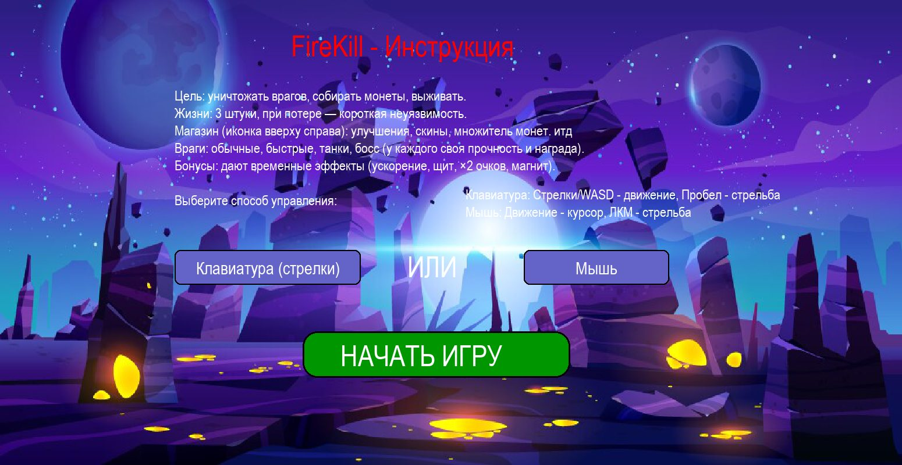

# 🔥 FireKill - Аркадный шутер на Python


**FireKill** — это динамичная аркадная игра-шутер, написанная на Python с использованием библиотеки Pygame. Уничтожайте врагов, собирайте монеты, улучшайте персонажа и открывайте достижения!

## 🎮 Геймплей

Вам предстоит управлять персонажем, который должен уничтожать волны врагов, уклоняться от атак и собирать монеты. С каждым уровнем сложность возрастает: враги становятся быстрее, появляются новые типы противников и боссы.


## ✨ Особенности

### 🎯 Разнообразные враги
- **Обычный враг** - базовый противник
- **Быстрый враг** - высокая скорость передвижения
- **Танк** - медленный, но требует 2 попадания
- **Босс** - мощный противник, появляется на высоких уровнях

### 💰 Система монет и магазин
- Собирайте монеты с поверженных врагов
- Покупайте улучшения в магазине:
  - 🚀 Увеличение скорости стрельбы
  - ❤️ Дополнительные жизни
  - ⚡ Увеличение скорости игрока
  - 🎨 Новые скины для персонажа
  - 💰 Множитель монет x2

### 🏆 Система достижений (32 шт!)
Отслеживайте свой прогресс и получайте награды:
- "Первый шаг" - наберите 100 очков
- "Снайпер" - уничтожьте 20 врагов
- "Босс-победитель" - победите босса
- "Мастер комбо" - соберите комбо x5
- "Бессмертный" - проживите 10 минут
- И многие другие!

### ⚡ Бонусы
- **Ускоренная перезарядка** - стреляйте быстрее
- **Щит** - временная неуязвимость
- **Доп. очки** - удвоение очков
- **Магнит** - притягивает монеты

### 🎮 Управление
- **Клавиатура**: Стрелки/WASD - движение, Пробел - стрельба
- **Мышь**: Движение курсором, ЛКМ - стрельба
- **M** - включить/выключить музыку

## 📸 Скриншоты

| Главное меню | Игровой процесс |
|---|---|
|  |  |

## 🛠 Установка и запуск

### Требования
- Python 3.10 или выше
- Библиотека Pygame

### Установка

1. **Клонируйте репозиторий:**
```bash
git clone https://github.com/Naruto456y/FireKill.git
cd FireKill
```

2. **Установите зависимости и запустите:**
```bash
pip install -r requirements.txt
python FireKill.py
```

### Сборка exe

```bash
pip install pyinstaller
pyinstaller FireKill.spec
```

## 📁 Структура

```
FireKill.py     игра
FireKill.spec   конфигурация PyInstaller
images/         спрайты, фон, иконки
sounds/         музыка и звуки
screenshots/    скриншоты для README
```

## 👤 Автор

Yusuf ([@Naruto456y](https://github.com/Naruto456y)). Лицензия [MIT](LICENSE).
